# Item Skill Requirement Expanded

A Mount & Blade II: Bannerlord mod (game v1.5.7, War Sails compatible) that makes skill requirements **soft**. You can
equip anything. If your skill is below what an item asks for, the requirement shows in red in the inventory and you
fight with the item worse: weaker and slower swings, a shield that breaks sooner, heavy feet in armour, a bow that
shoots weak and wide, a horse that answers the reins badly. Nothing is ever locked for the heroes the mod covers.

The rule of thumb: **an item a tier or two above your skill comes out worse than the one you have mastered.** A rich
trader can still wear a noble sword for show; it just won't beat a good sword he has trained for.

Troops are never touched. They fight exactly as in vanilla.

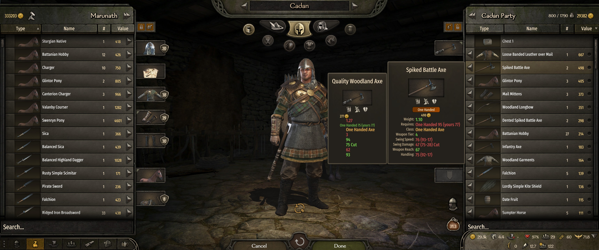

## Install

1. Get it from [Nexus Mods](https://www.nexusmods.com/mountandblade2bannerlord/mods/14526),
   subscribe on the [Steam Workshop](https://steamcommunity.com/sharedfiles/filedetails/?id=3834307298),
   or download the zip from the [GitHub Releases page](https://github.com/TraxData313/item-skill-requirement-expanded/releases/latest).
2. Extract it into `Mount & Blade II Bannerlord\Modules\`.
3. Enable it in the launcher, below Harmony (and MCM if you use it). Requires
   [Harmony](https://www.nexusmods.com/mountandblade2bannerlord/mods/2006);
   [Mod Configuration Menu](https://www.nexusmods.com/mountandblade2bannerlord/mods/612) is optional.

## Screenshots

| | |
|---|---|
| 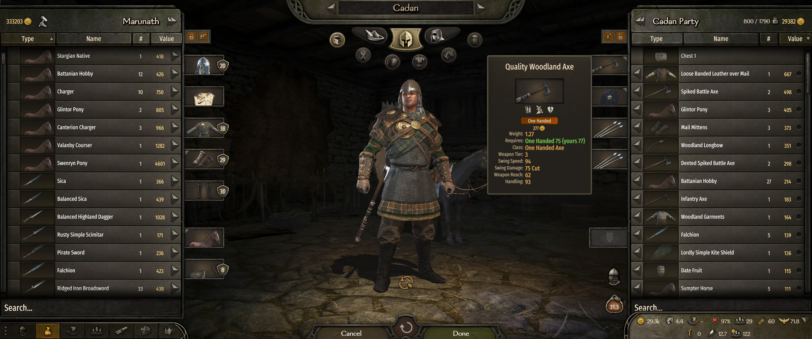 **1.** Requirement met: One Handed 75 (yours 77), green, no penalty. |  **2.** A Tier 4 axe asks 95: swing speed, damage and handling shown after the penalty. |
| 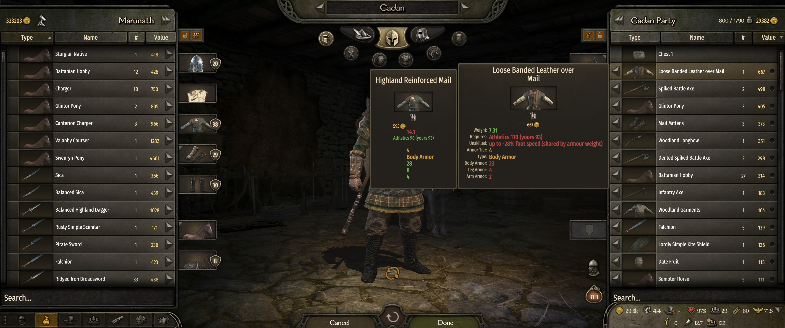 **3.** Body armour above your Athletics: up to -28% foot speed, shared by armour weight. | 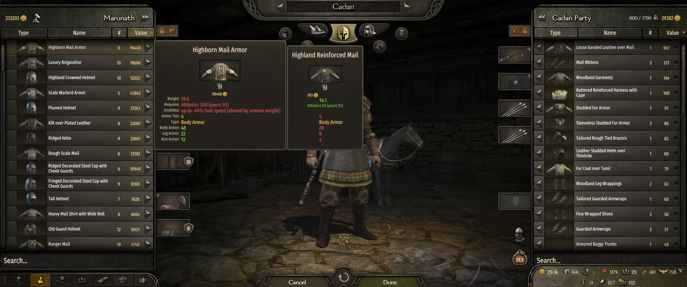 **4.** Tier 6 armour asks Athletics 200: up to -49% foot speed. |
| 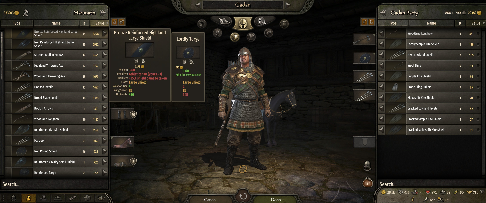 **5.** A shield above your Athletics takes +35% damage. | 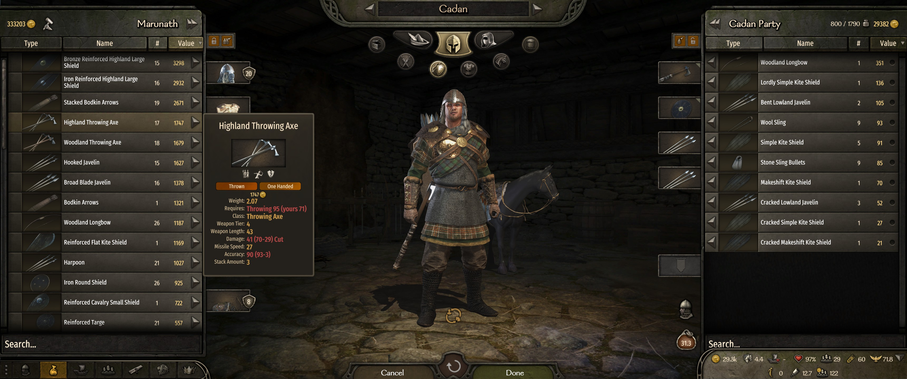 **6.** Throwing axe, thrown tab: asks Throwing, damage and accuracy after the penalty. |
| 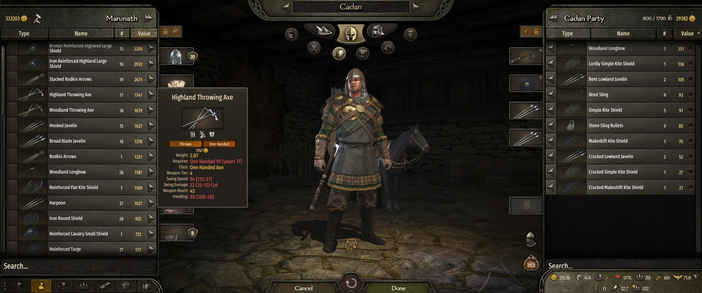 **7.** The same axe, one-handed tab: asks One Handed instead. | 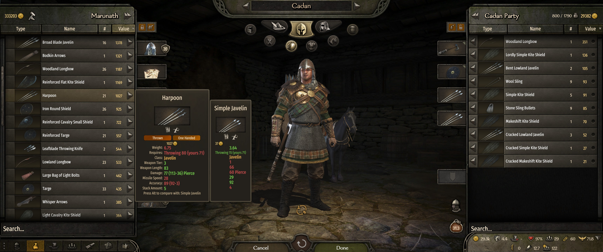 **8.** Harpoon (Throwing 80) next to a Simple Javelin you have mastered. |
| 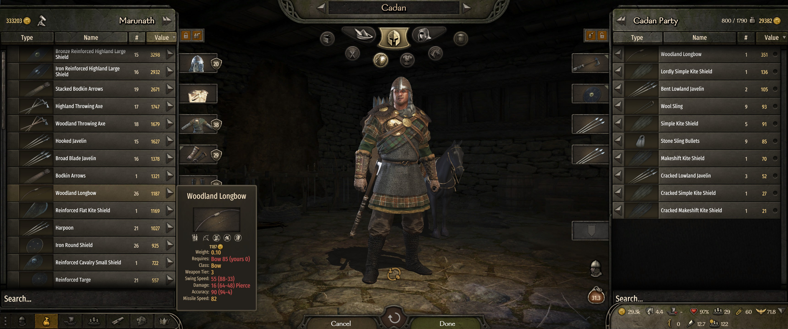 **9.** A Tier 3 longbow at Bow 0: equippable, but weak and wide. | 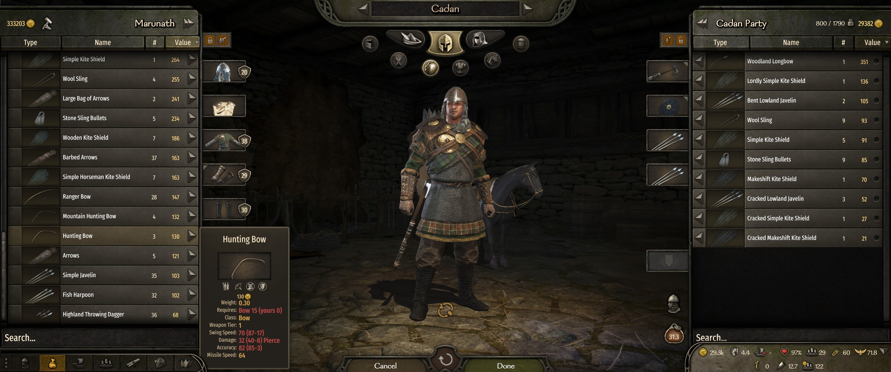 **10.** Starter gear: a Tier 1 Hunting Bow at Bow 0 costs only 20%. |
| 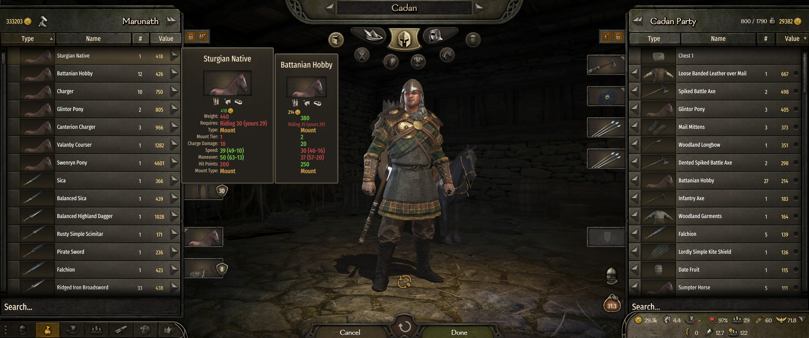 **11.** Horses ask Riding: speed and maneuver after the penalty. | 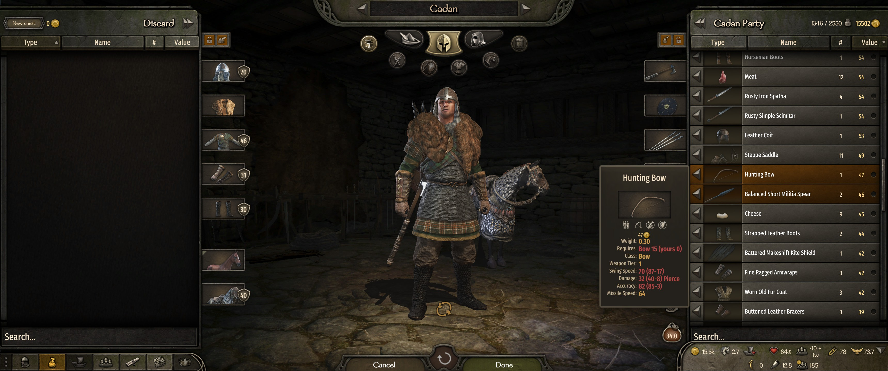 **12.** v1.1.0: items above the hero's skill show orange in the inventory; vanilla red still means "can't equip". |
| 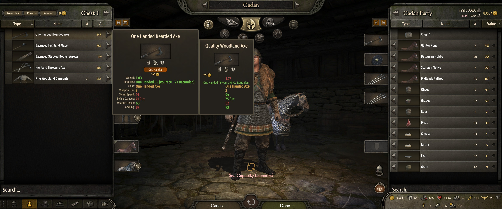 **13.** v1.2.0: Battanian gear on a Battanian hero, "Requires: One Handed 85 (yours 91 +23 Battanian)". | |

## What asks for what

Every covered item asks one skill at one requirement **R**, read from the item's tier:

| Item | Skill |
|---|---|
| One-handed, two-handed, polearm weapons | the skill of the way you hold it (a bastard sword asks One Handed in one hand, Two Handed in two) |
| Javelins, throwing axes and knives | Throwing when thrown, their melee skill when held |
| Shields | Athletics |
| Armour (head, body, legs, gloves, cape) | Athletics |
| Bows / crossbows / slings | Bow / Crossbow / Throwing |
| Horses | Riding |

Arrows, bolts, stones, banners, pack animals, harness and goods ask nothing. Arrows and bolts use the bow or crossbow
in your hands.

### The tier table

R follows the item's exact tier (vanilla's "Tier N" is that number rounded) in straight lines between these points,
rounded to 5:

| Item tier | 0 | 1 | 2 | 3 | 4 | 5 | 6 | 7.5 and up |
|---|---|---|---|---|---|---|---|---|
| R | 0 | 20 | 45 | 75 | 100 | 125 | 150 | 200 |

Vanilla shows "Tier 6" from an exact tier of 5.5, so Tier 6 gear asks about 140 to 200. Some examples:

| Item | Shown tier | R |
|---|---|---|
| Backsword | 3 | 75 |
| Heavy Mail Shirt with Wide Belt | 5 | 125 |
| Falx | 6 | 160 |
| Highland Fine Two Handed Sword | 6 | 160 |
| Luxury Scale Armor (20 kg) | 6 | 200 |
| Noble Long Bow | 6 | 180 |
| Swenryn Pony / Glintor Pony | 4 / 3 | 100 / 60 |
| Druzhinnik Kite Shield | 6 | 160 |

Bows, crossbows and horses use this table too (not their vanilla difficulty), and they no longer lock you out: you
can equip them and mount any horse, and pay the penalty instead.

## How much it costs: the snap curve

- **Skill at or above R: no penalty at all.** The moment you reach the requirement, the item is yours.
- Below R the penalty starts at once at its **Low** value and grows in straight lines, by how much of R you have:

| Your skill as a share of R | just under 100% | 90% | 80% | 60% | 45% | 30% and below |
|---|---|---|---|---|---|---|
| Penalty | Low | | | Mid | | High |
| Weapon damage (default) | -25% | -31% | -38% | -50% | -63% | -75% |

Each stat has its own Low / Mid / High (defaults):

| Item | Stat | Low / Mid / High |
|---|---|---|
| Melee weapon | damage | -25 / -50 / -75% |
| | swing and thrust speed | -12.5 / -25 / -37.5% |
| | handling | -12.5 / -25 / -37.5% |
| Thrown weapon (javelin thrown) | damage | -25 / -50 / -75% |
| | inaccuracy | +25 / +50 / +75% |
| Bow / crossbow / sling | damage | -25 / -50 / -75% |
| | draw and reload speed | -12.5 / -25 / -37.5% |
| | inaccuracy | +25 / +50 / +75% |
| Shield | damage the shield takes | +25 / +50 / +75% |
| Armour | foot speed | -20 / -40 / -60% |
| Horse | speed, maneuver | -25 / -50 / -75% |

**Starter gear**: Tier 1 gear has no easier option (there are no tier 0 bows or spears), so a hero
with no skill would otherwise have nothing to learn on. Every item of Tier 1 or lower (the tier the game shows) -
melee weapons (held and thrown), shields, armour, bows, crossbows, slings and horses - costs at most **20%** on each
stat: a Hunting Bow (Tier 1, R 15) at Bow 0 loses 20% damage and 20% draw speed and gets +20% spread, a Tier 1 spear
at Polearm 0 loses 20% damage, swing speed and handling, a Tier 1 horse at Riding 0 loses 20% speed and maneuver -
not 75%. Armour is capped per piece before the weight share, so a whole Tier 1 set at Athletics 0 costs 20% foot
speed. Both the tier and the cap are settings; a cap of 100% switches it off.

**Armour** is judged piece by piece, each by its own R, and the result is shared by weight: a 1 kg helmet just out of
reach under a 20 kg cuirass you master costs about 1% speed; the whole set far out of reach costs the full 60%.

Example: One Handed 71 with a Tier 6 sword (R 160, 44% of R) loses 63% of its damage. The same hero with a Tier 3
sword (R 75, 95% of R) loses 28%; at One Handed 75 he loses nothing.

## Same culture bonus

Since v1.2.0 a hero knows his own people's gear better. When an item's culture is the hero's culture (a Battanian in
Battanian armour), his skill counts as **skill x 1.2 + 5** before it is compared to R and before the penalty curve.
Items with no culture, or the game's neutral culture, give no bonus.

Example: a tier 7.5 Battanian armour asks Athletics 200. A Battanian meets it from Athletics **163**
(163 x 1.2 + 5 = 200.6); at 162 (199.4) he is still just short. At Athletics 150 the tooltip reads
`Requires: Athletics 200 (yours 150 +35 Battanian)`, red, and he pays the penalty of 185, not of 150.

The bonus counts everywhere the skill meets R: battle, the tooltip colour and numbers, and the orange rows. The
points, the multiplier and an on/off switch are settings.

## Who is affected

| Who | Default |
|---|---|
| You | on |
| Your clan's heroes (companions, family) | on |
| Every other hero, friend and foe | on |
| Penalties in tournaments | off |
| Penalties in training (Training Battles drills, the training field, arena practice) | off |
| Troops | **never** - vanilla, including vanilla's bow and horse locks |

A hero the toggles leave out is treated like a troop: vanilla stats, vanilla locks, vanilla tooltip.

## The inventory tooltip

- `Requires: Two Handed 160 (yours 71)` - red when short, green when met, per usage tab (a bastard sword shows One
  Handed on its one-handed tab and Two Handed on its two-handed tab). Gear of the hero's own culture shows the bonus:
  `Requires: Athletics 200 (yours 150 +35 Battanian)`; the colour follows the boosted value (the bonus is rounded
  down, so a red line never adds up to R).
- When short, the stat rows show the value **after** the penalty, then the vanilla value minus the penalty:
  `Swing Damage: 37 (99-62) Cut`, horse `Speed: 39 (52-13)`, bow `Accuracy: 79 (83-4)`. Comparing two items, the
  green / red "better / worse" colours compare the after-penalty values.
- Shields and armour have no stat row for their penalty, so they get one red line instead:
  `Unskilled: +50% shield damage taken`, or `up to -40% foot speed (shared by armour weight)`.

## Orange rows in the inventory list

Since v1.1.0 the inventory lists (both sides) tint an item **orange** when its requirement is above the selected
hero's skill (with the same culture bonus): you can equip it, but you will fight with it at a penalty. Vanilla's **red** still means "this hero
can't use it at all" (wrong gender, not for the civilian set, a hard lock) and always wins over orange. A weapon with
two uses (bastard sword, javelin) is judged by its first use - the tab its tooltip opens on. Switch heroes with the
arrows and the rows follow the new hero's skills. Only heroes the toggles above cover get orange rows; turn it off with
**Highlight items above your skill** (MCM, Inventory group). No extra mod needed: it is a brush the mod ships in its
own `GUI\Brushes` folder.

## Settings

Everything is in the in-game **Mod Configuration Menu** (Mod Options > Item Skill Requirement Expanded) if you have MCM
(Bannerlord.MBOptionScreen) installed:

- **Who is affected**: the four toggles above.
- **Inventory**: highlight items above your skill (orange rows; default on).
- **Same culture bonus**: on/off (default on), **Same culture bonus (+points)** (0 to 50, default 5) and
  **Same culture bonus (x multiplier)** (1.00 to 2.00 in steps of 0.05, default 1.20).
- **Requirements**: every point of the tier table, the top tier, and a scale per category (melee, shields, armour,
  ranged, horses; 0 = no requirement for that category).
- **Penalty curve**: where Mid and High sit (default 60% and 30% of R).
- **Every Low / Mid / High** of every stat above.
- **Starter gear** (its own group, right after Penalty curve): the highest tier that counts as starter gear
  (default 1) and the most any one penalty of it can cost (default 20%), for every category.
- **Debug**: write `item_requirements.csv` (every item's tier, skill and R) at game start.

Changes apply at once: penalties at the next hit or stat refresh, the tooltip when you next hover, requirements on
the next item looked at. Sliders set out of order are read sanely: a Mid below Low counts as Low, a High below Mid as
Mid, and a tier asking less than the tier below it asks the same as that one. A High point set above the Mid point
puts both back to 60% / 30%. Without MCM the mod runs on the defaults.

## Compatibility

- **trax_combat_enhancements** (and other mods that change the combat models): Item Skill Requirement Expanded wraps whatever
  agent-stat and damage models were registered before it and only multiplies on top. Trax's Athletics stamina and
  Item Skill Requirement Expanded's penalties stack (a tired hero in armour above his Athletics is slower for both reasons). Load order
  does not matter for that; Item Skill Requirement Expanded asks to load after trax so the chain is tidy.
- **War Sails**: its naval models are wrapped the same way.
- Needs **Harmony** (Bannerlord.Harmony): equipping bows and horses above vanilla's lock, mounting any horse in
  battle, the tooltip and the orange rows. If a game update breaks one of those patches, that part is skipped and logged; the
  combat penalties still work.
- MCM is optional.
- Nothing is saved into your campaign. You can add or remove the mod mid-campaign.

## Known limits

- **The tooltip uses your plain skill; battle uses the effective skill** (captain perks and the like add to it, as in
  vanilla), so a battle can be a few points kinder than the tooltip.
- An arrow's damage penalty follows the launcher in your hands when it lands: switch to a sword before your arrow
  hits and that arrow pays nothing.
- The horse tooltip shows the horse without harness; battle multiplies the speed after harness and Riding bonuses, so
  the numbers differ a little, the percentage does not.
- A horse a hero mounts in the middle of a battle now also gets vanilla's own Riding bonus from him (vanilla forgot
  to refresh it).
- Items another mod gives a vanilla difficulty on melee weapons, shields or armour stay hard-locked as in vanilla.
- The tooltip text is English only for now.
- Orange rows are in the item lists only, not on the hero's equipped slots. A mod that replaces the inventory
  item-row widget with its own type would not get them.

## Build

```
dotnet build ItemSkillRequirementExpanded.sln -c Release
dotnet test tests\ItemSkillRequirementExpanded.Core.Tests -c Release
powershell -ExecutionPolicy Bypass -File tools\deploy.ps1
```

Set your game path in `Directory.Build.props.user` if it differs from `Directory.Build.props`.

## License

Public domain (The Unlicense), see `LICENSE`.
